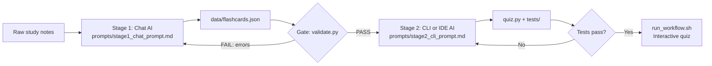

# AI Flashcard Workflow: Chat AI → CLI/IDE AI

Turn messy study notes into a working terminal quiz app using two different AI UX types.

| Stage | UX type | Input | Output |
|-------|---------|-------|--------|
| 1 | **Chat** (ChatGPT, Gemini, Claude, etc.) | Raw notes (`data/sample_notes.txt`) | `data/flashcards.json` |
| Gate | Plain Python, no AI | `flashcards.json` | PASS or a list of errors |
| 2 | **CLI** (Claude Code, Gemini CLI, Codex CLI) **or IDE** (Copilot, Cursor) | `flashcards.json` + `validate.py` | `quiz.py` + tests |

## 1. The problem

Making flashcards by hand from notes is slow, and building a tool to study them is slower.
The task splits naturally into two stages: **understanding text** (what chat AI is good at)
and **writing and testing code inside a project** (what CLI/IDE AI is good at).

## 2. Workflow diagram



Text version (if Mermaid doesn't render):

```
 Notes ──► [Chat AI] ──► flashcards.json ──► [validate.py] ──PASS──► [CLI/IDE AI] ──► quiz.py + tests ──► Quiz
              ▲                                   │                       ▲                │
              └──────── errors pasted back ───────┘                       └── tests fail ──┘
```

**The key idea:** the two AIs never talk to each other directly. They share a **file with a fixed
format** (the JSON contract). `validate.py` checks that contract, so either AI can be swapped out.

## 3. Project files

```
ai-flashcard-workflow/
├── README.md                    ← this document
├── prompts/
│   ├── stage1_chat_prompt.md    ← paste into any chat AI
│   └── stage2_cli_prompt.md     ← paste into any CLI or IDE AI
├── data/
│   ├── sample_notes.txt         ← test input (Git basics notes)
│   └── flashcards.json          ← Stage 1 output (handoff file)
├── validate.py                  ← handoff gate (no AI, stdlib only)
├── quiz.py                      ← Stage 2 output (the app)
├── tests/test_workflow.py       ← 12 unit tests
├── run_workflow.sh              ← one command: validate → test → quiz
└── docs/test_run_log.txt        ← proof of an end-to-end run
```

Requirements: Python 3.8+ only. No packages to install.

## 4. Step-by-step

### Step 1: Generate flashcards (Chat AI)
1. Open `prompts/stage1_chat_prompt.md` and copy the prompt.
2. Paste it into any chat AI, and replace `<paste your notes here>` with the contents of `data/sample_notes.txt` (or your own notes).
3. Copy the reply and save it as `data/flashcards.json`.

### Step 2: Check the handoff (Gate)
```bash
python3 validate.py
```
- `PASS` → go to Step 3.
- `FAIL` → copy the error list back into the same chat and say *"Fix these errors and return only the JSON."* Save and re-run.
  (Code fences like ```` ```json ```` are removed automatically, so that common chat habit won't break anything.)

### Step 3: Build the app (CLI or IDE AI)
1. Open a terminal in the project folder (CLI) or open the folder in your editor (IDE).
2. Start your AI tool, for example `claude`, `gemini`, or Copilot Chat in agent mode.
3. Paste the prompt from `prompts/stage2_cli_prompt.md`.
4. The AI writes `quiz.py` and tests, runs the tests, and fixes failures.

> A reference `quiz.py` and tests are included, so the project runs even before you do Step 3.
> To practice the real workflow, delete `quiz.py` and `tests/`, then let your AI rebuild them.

### Step 4: Run everything
```bash
./run_workflow.sh          # macOS / Linux / Git Bash
```
On Windows PowerShell, run the three commands one at a time:
```
python validate.py
python -m unittest discover -s tests
python quiz.py --shuffle
```

Other quiz options:
```bash
python3 quiz.py --list                  # study sheet, no quiz
python3 quiz.py --difficulty hard       # only hard cards
python3 quiz.py --shuffle --limit 5     # 5 random cards
```

## 5. Testing results

Full log: `docs/test_run_log.txt`. Summary:

| Check | Result |
|-------|--------|
| Sample deck passes the gate |  PASS, 12 cards |
| Unit tests |  12/12 pass |
| Quiz run (hard cards, 1 right / 1 wrong) |  Score 1/2 (50%), missed card listed |
| Broken AI output (missing answer, bad difficulty, duplicate id) |  Caught, 4 clear errors, exit code 1 |
| One-command run (`run_workflow.sh`) |  Gate → tests → quiz |

## 6. Adaptability (tool-agnostic design)

- **Plain-text prompts** with no tool-specific features. They work in any chat, CLI, or IDE AI.
- **File-based handoff.** Stage 2 only needs `flashcards.json`, not the chat tool that made it.
- **Contract enforced by code, not by trust.** Any model can be used in Stage 1 because `validate.py` rejects bad output.
- **Stage 2 is interchangeable between CLI and IDE.** The same prompt works in Claude Code, Gemini CLI, Codex CLI, Copilot, or Cursor.
- **No dependencies.** Python standard library only; works on Windows, macOS, and Linux.
- **New topics need no code changes.** Swap the notes file and repeat Step 1.

## 7. Efficiency

Rough estimates for 12 cards plus a working quiz tool:

| Task | Manual | With this workflow |
|------|--------|--------------------|
| Write 12 flashcards from notes | ~30 min | ~1 min (one chat prompt) |
| Check the format | Read through by eye | Instant (`validate.py`) |
| Build and test a quiz app | 1–2 hours | ~5 min (one CLI/IDE prompt) |
| Next topic | Repeat everything | ~2 min (new notes → Step 1 → run) |

The biggest saving is reuse: after the first run, a new topic only needs Step 1.

## 8. Troubleshooting

| Problem | Fix |
|---------|-----|
| `FAIL: invalid JSON` | The chat added text around the JSON. Ask for "only valid JSON" and save again. |
| `difficulty must be one of...` | Paste the error into the chat; it will fix the values. |
| `python3: command not found` (Windows) | Use `python` instead of `python3`. |
| `./run_workflow.sh: Permission denied` | Run `chmod +x run_workflow.sh` or use `bash run_workflow.sh`. |

## 9. Evaluation criteria mapping

| Criterion | Where it is shown |
|-----------|-------------------|
| Functionality (40%) | `run_workflow.sh`, 12 passing tests, `docs/test_run_log.txt` |
| Adaptability (20%) | Section 6, generic prompts, file contract, stdlib only |
| Documentation (20%) | Diagram (Section 2), steps (Section 4) |
| Efficiency (20%) | Section 7, one-command run, automatic error feedback loop |
